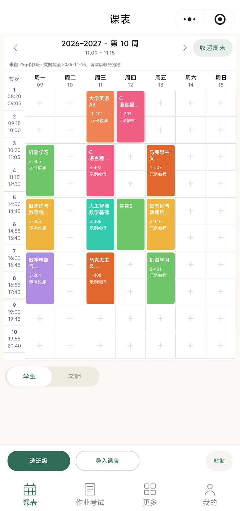
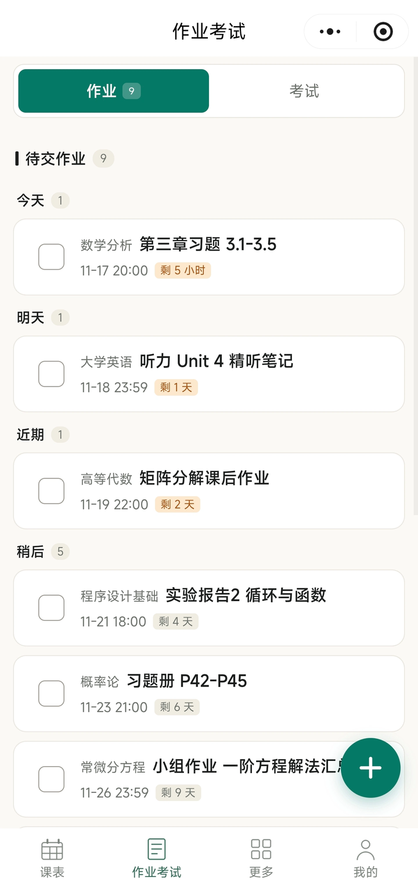
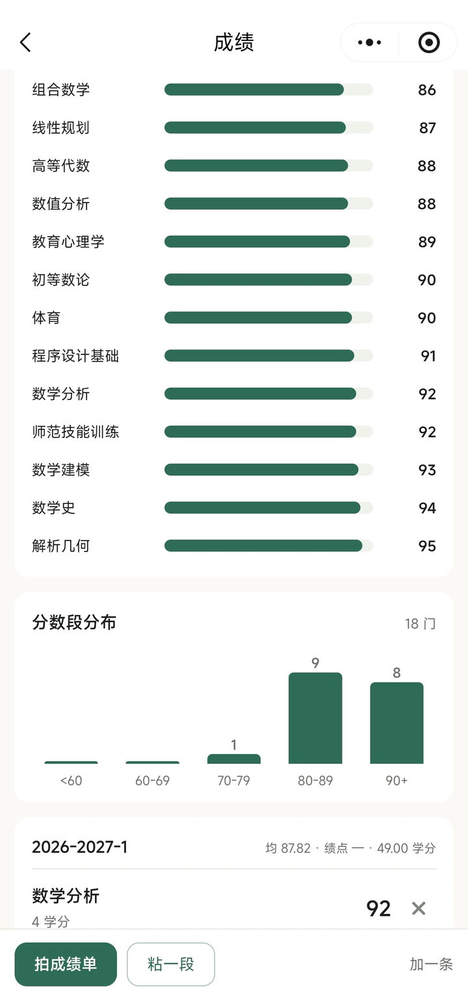
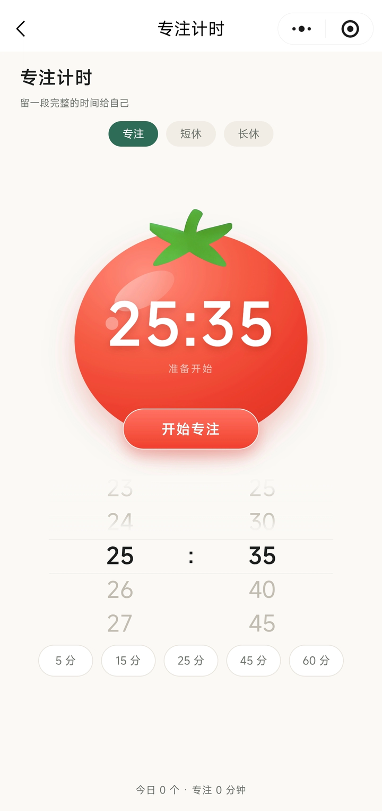
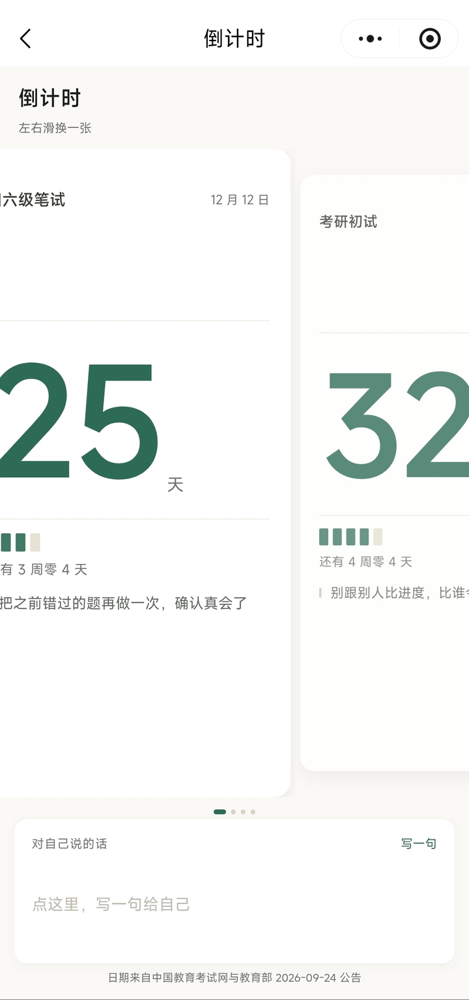
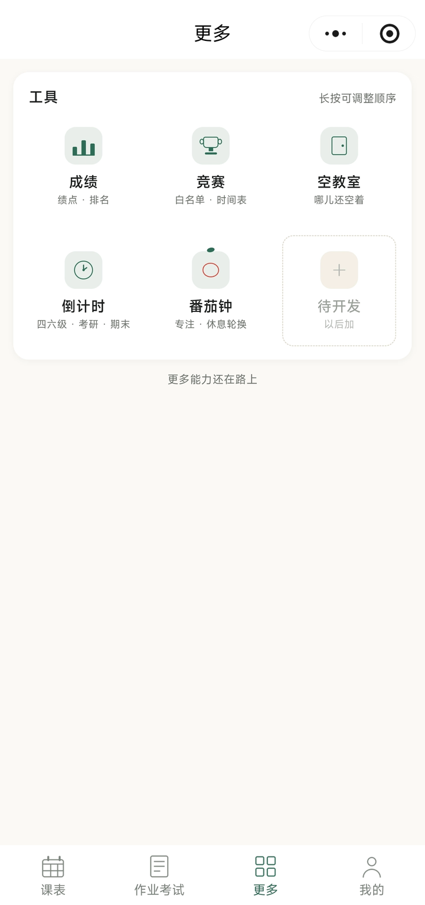

<div align="center">

# Campus Learning Platform

纯本地运行的校园学习工具集合：课表、作业、考试、成绩、竞赛、专注计时，收进同一个微信小程序。没有后端，不发网络请求，数据只留在本机。

[](LICENSE)


</div>

## 预览

| 课表 | 作业考试 | 成绩 |
| :---: | :---: | :---: |
|  |  |  |

| 专注计时 | 倒计时 | 更多工具 |
| :---: | :---: | :---: |
|  |  |  |

## 项目

| 目录 | 项目 | 形态 | 说明 |
| --- | --- | --- | --- |
| `apps/timetable-miniprogram/` | 校园课表小程序 | 微信原生小程序 | 九个页面，三屏跟手翻周、表格导入、端侧 OCR、空教室、竞赛清单、番茄钟 |

后续新增的独立工具都放在 `apps/` 下，各自目录自带说明与运行方式。

## 功能

| 模块 | 能力 |
| --- | --- |
| 课表 | 按周查看，三屏缓冲区左右跟手翻周，5 天 / 7 天切换，今天与当前节次高亮 |
| 作业考试 | 按日期分组的待办清单，支持粘贴通知文本或识别截图，考试卡带课程配色条 |
| 成绩 | 成绩单导入或单条录入，个人成绩 / 专业考试 / 综测三类分组，配横向条、分数段分布与学期汇总 |
| 空教室 | 按时间段查本班课表以外的空闲教室 |
| 竞赛 | 按月分组的赛事清单，日期状态标记与关注星标 |
| 倒计时 | 课程节点与考试倒计时，周数进度条，可写一句给自己的备注 |
| 番茄钟 | 专注 / 短休 / 长休轮换，统计今日次数与专注时长 |

## 快速开始

1. 克隆本仓库。
2. 微信开发者工具导入 `apps/timetable-miniprogram`。
3. AppID 填自己的，或直接用测试号；仓库里的 `touristappid` 是占位。
4. 直接编译。不需要装依赖，不需要配服务器域名。

打开后默认加载示例课表与演示数据，六个虚构班级、十条作业、五场考试、二十二条成绩，可以立刻看到翻周、分组清单、成绩图表这些效果。

## 目录

```
apps/                 各个独立项目，一个子目录一套
skills/               可复用的设计与实现经验，每个 Skill 一个目录
docs/                 仓库级约定
```

## 示例数据

`apps/timetable-miniprogram/data/kb-data.js` 是一份虚构课表快照。

- 一个学院，两个专业，六个班级。
- 十四门公共课，十位虚构教师，九个教室与场馆。
- 六十九条记录，分布在周一至周日，周次写法覆盖 `1-16`、`1-8`、`3-16`、`5-15(单)`、`1-12(双)`、`6,8-12`、`9-16`。

`apps/timetable-miniprogram/data/demo-state.js` 补上其余页面的内容，同样全部虚构：

- 十条作业，覆盖逾期、今天、三天内、本周、下周与不设截止。
- 五场考试，日期按打开当天往后偏移，隔多久编译都不过期。
- 二十二条成绩，分个人成绩、专业考试、综测三类。
- 首次启动自动写入，在「我的」页清空数据即回到空态。

记录格式与教务导出完全对应，接自己的数据时整份替换即可，代码不用动。

## 隐私与数据红线

这个仓库对真实教务数据零容忍。提交前自查：

- 不出现真实校名、校内文号、教务处文件编号。
- 不出现真实班级名、学号、姓名、手机号、邮箱。
- 不出现真实教师姓名与真实教室编号。
- 不提交 `*.xls`、`*.xlsx`、`*.csv`、导出的课表 json 与成绩单 json，`.gitignore` 已拦截，不要用 `-f` 强行加进来。
- 竞赛清单只保留公开渠道可查的赛程与承办信息，不写校内通知原文。

示例数据统一使用示例前缀，比如 `示例学院`、`25示例1班`、`1-101`。

## Skills

| Skill | 用途 |
| --- | --- |
| `skills/wechat-miniprogram-timetable/` | 小程序课表的三屏坐标系、手势状态机、视觉口径、验证方法，附踩坑记录 |

Skill 目录可以直接复制到 `~/.agents/skills/` 或对应客户端的 skills 目录使用。

## 许可

MIT，见 [LICENSE](LICENSE)。
